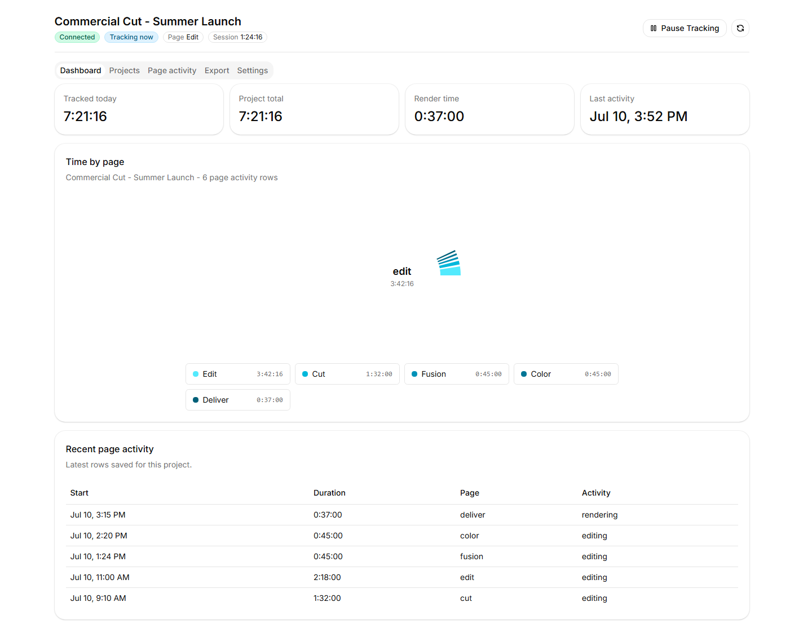

# Resolve Time Tracker

Resolve Time Tracker is an open-source time tracker for DaVinci Resolve Studio. It records editing time per project, pauses when you are idle or switch apps, and keeps your history locally in SQLite.

<p align="center">
  <a href="https://github.com/Today20092/Davinci-Resolve-TimeTracker/releases/tag/v0.1.2-alpha.1"></a>
  <a href="docs/platform-support.md"></a>
  <a href="LICENSE"></a>
</p>

[Install](#install) · [Usage guide](docs/usage.md) · [Release notes](https://github.com/Today20092/Davinci-Resolve-TimeTracker/releases/tag/v0.1.2-alpha.1) · [Troubleshooting](docs/troubleshooting.md) · [Development](docs/development.md)

**The newest published release is v0.1.2-alpha.1, an alpha prerelease.** It provides source archives, with no standalone installer. Playback can still be undercounted, and the dashboard exceeds resource targets. Review the [known limits](docs/releases/0.1.2-alpha.1.md#validation-and-known-limits) before relying on totals for billing.

## Install

<a id="requirements"></a>

DaVinci Resolve Studio is required. The source setup also needs Git, uv, Python 3.13, and Node.js with the pinned pnpm version.

Open the release page below, expand **Assets**, and download **Source code**. All platforms use the same source release.

| Platform | Download | Setup and support |
| --- | --- | --- |
| Windows | [v0.1.2-alpha.1 source](https://github.com/Today20092/Davinci-Resolve-TimeTracker/releases/tag/v0.1.2-alpha.1) | [Source setup](docs/usage.md#install-the-published-alpha). Exercised with Resolve Studio 21.1.1.10. |
| macOS | [v0.1.2-alpha.1 source](https://github.com/Today20092/Davinci-Resolve-TimeTracker/releases/tag/v0.1.2-alpha.1) | [Source setup](docs/usage.md#install-the-published-alpha). Real-machine testing remains outstanding. |
| Linux | [v0.1.2-alpha.1 source](https://github.com/Today20092/Davinci-Resolve-TimeTracker/releases/tag/v0.1.2-alpha.1) | [Source setup](docs/usage.md#install-the-published-alpha). X11 needs `xprintidle` and `xdotool`; Wayland activity detection is unavailable. |

Close Resolve and the dashboard and back up `tracker.sqlite3` before updating. The [installation and usage guide](docs/usage.md) also covers bootstrap scripts for current `main`, updates, and uninstalling.

For a one-command macOS install of current `main`, run this in Terminal (requires Git and Node.js with pnpm):

```sh
curl -fsSL https://raw.githubusercontent.com/Today20092/Davinci-Resolve-TimeTracker/main/install.sh | sh
```

This downloads and immediately runs the installer. To inspect it first, [download install.sh](https://raw.githubusercontent.com/Today20092/Davinci-Resolve-TimeTracker/main/install.sh) before running it.

## Why use it?

- See time by Resolve project and page, with saved sessions and CSV/PDF reports.
- Start tracking explicitly through Resolve's Scripts menu or the Windows tracked shortcut installed by the bootstrap route.
- Open the dashboard when you need it. Closing it leaves tracking active while the tracked Resolve session is open; closing both stops the runtime.
- Keep data on your computer. The tracker never records keystrokes, mouse coordinates, screen contents, footage, or media contents.

## Use

Attach tracking to an open Resolve session with:

```text
Workspace > Scripts > ResolveTimeTrackerMenu
```

On Windows bootstrap installations, **DaVinci Resolve + Time Tracker** starts Resolve with tracking. **Resolve Time Tracker Dashboard** opens saved time and reports. The dashboard alone and Resolve's ordinary shortcut do not start tracking.

Use **Pause Tracking** and **Resume Tracking** for manual control. CSV exports include closed sessions only. See the [usage guide](docs/usage.md#use) for details.

## Screenshots

This dashboard uses sample project data. See the [full gallery](docs/usage.md#screenshots) for projects, page activity, exports, and settings.



## How tracking works

The tracker counts foreground work while you are active and keeps tracking during render/export. Playback observations remain incomplete in this alpha. See [tracking rules and data locations](docs/usage.md#how-tracking-works).

## Platform support

Windows has live Resolve Studio evidence. macOS and Linux support exists in code and still needs real-machine validation. See [platform support](docs/platform-support.md) for requirements and limitations.

## Need help?

Start with [troubleshooting](docs/troubleshooting.md). For connection or performance issues, open **Settings > Support report** and choose **Copy report** or **Save report**. Attach it to a [GitHub issue](https://github.com/Today20092/Davinci-Resolve-TimeTracker/issues). Reports exclude Resolve project names and tracking history.

## Architecture

See the [runtime flow, installation flow, and component map](docs/architecture.md).

## Development and contributing

The [development guide](docs/development.md) covers setup, hot reload, tests, and builds. Read [CONTRIBUTING.md](CONTRIBUTING.md) before opening a pull request. The [agentic development prompt](docs/agentic-development-prompt.md) provides checkout instructions for an AI coding agent.

This project is still evolving. Clone it, fork it, or adapt it to your workflow.

## Credits

Inspired by Jamie Fenn's [DaVinci Resolve time tracker concept and launch video](https://youtu.be/hPOm9HM6S_o) and [Time Tracker](https://www.jamiefenn.com/p/time-tracker/).

This is an independent open-source implementation. It is not affiliated with, endorsed by, or a copy of Jamie Fenn's commercial product.

## License

MIT. See [LICENSE](LICENSE).
