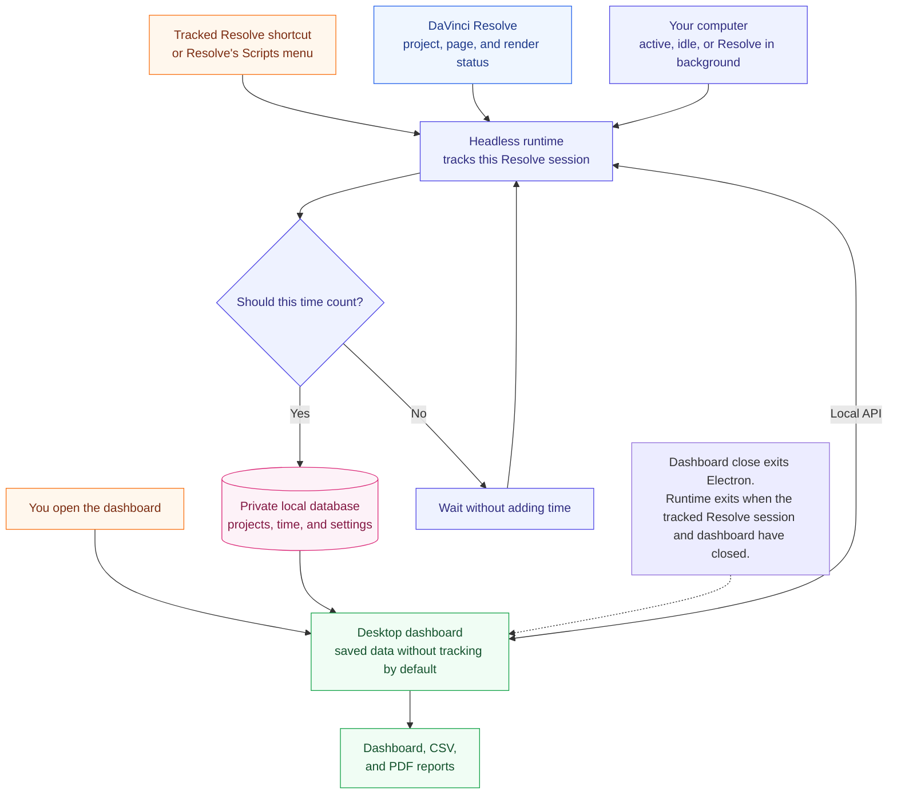
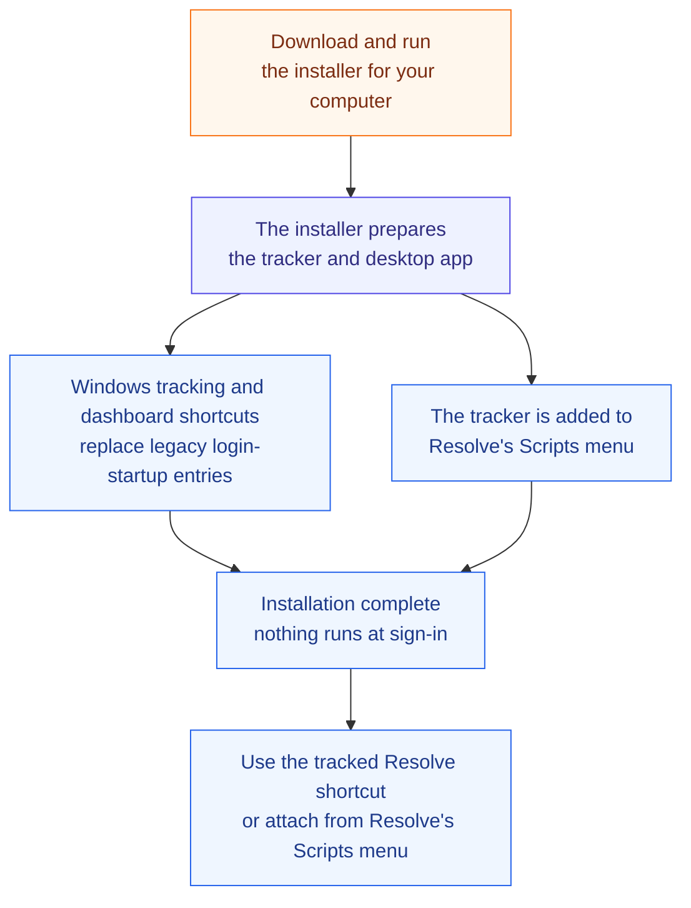

# Architecture

[Back to the README](../README.md) · [Development guide](development.md)

### Diagram Key

Both diagrams use the same visual language:

- **Orange:** where the user starts an action.
- **Blue:** DaVinci Resolve.
- **Green:** the desktop app and results visible to the user.
- **Purple:** background work performed by the tracker.
- **Pink:** data stored privately on the computer.
- **Rectangle:** an action or part of the tracker; **diamond:** a choice; **cylinder:** stored data; **dotted line:** an explanatory note rather than a runtime step.

### Runtime Flow

How Resolve, the desktop companion, the local Python sidecar, and local storage talk to each other while the tracker is running.

### Install Flow

What the one-file installer prepares before the menu item appears inside DaVinci Resolve.

| Area | Files | Responsibility |
| --- | --- | --- |
| Plugin entry | `scripts/ResolveTimeTracker.py` | Opens the built dashboard by default; `--tracked-launch` starts or attaches Resolve tracking, and `--api` attaches a dashboard owner to the managed runtime. |
| Install path | `install.py`, `install.ps1`, `install.sh`, `scripts/install_resolve_menu.py` | Prepares Python and frontend dependencies, then installs the Resolve Scripts-menu launcher. |
| Interface | `frontend/` | Electron owns the dashboard window and desktop PDF printing and exits when the window closes; React, Vite, Tailwind, and shadcn/ui render the dashboard. |
| Runtime lifecycle | `src/resolve_time_tracker/runtime_host.py`, `src/resolve_time_tracker/tracked_launch.py` | Shares one runtime per database while a tracked Resolve session or dashboard owns it. Publishes an ephemeral localhost endpoint in the database's `.runtime.json` file. |
| Backend API | `src/resolve_time_tracker/api.py` | FastAPI exposes localhost commands, exports, server-sent invalidations, and the complete dashboard read model consumed by React. |
| Tracking rules | `src/resolve_time_tracker/tracking_engine.py` | Converts Resolve/runtime snapshots into billable Sessions with heartbeats. |
| Resolve adapter | `src/resolve_time_tracker/resolve_bridge.py` | Reads project, Page, render, timeline, idle, and foreground state. |
| Storage | `src/resolve_time_tracker/database.py` | Stores Projects, active Session, closed Sessions, settings, heartbeat recovery, summaries, and CSV output in SQLite. |
