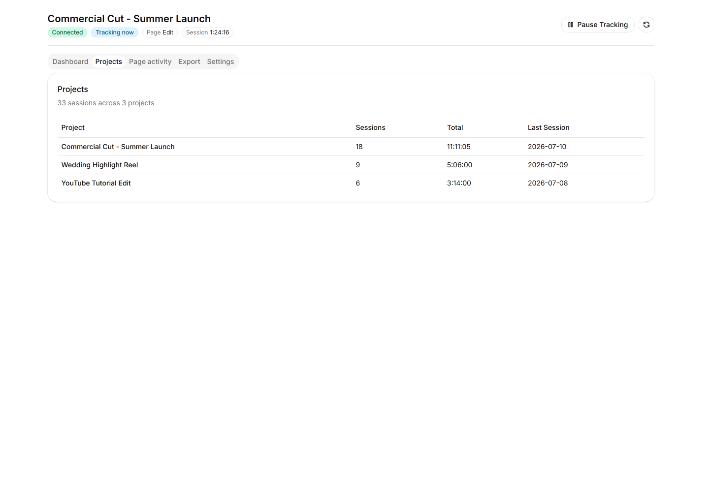
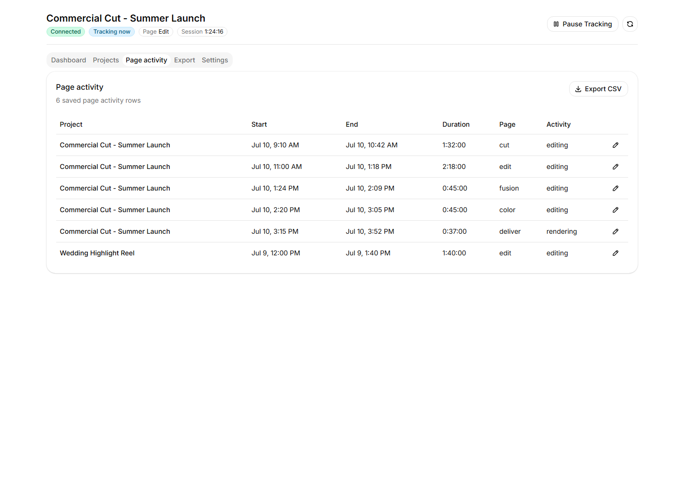
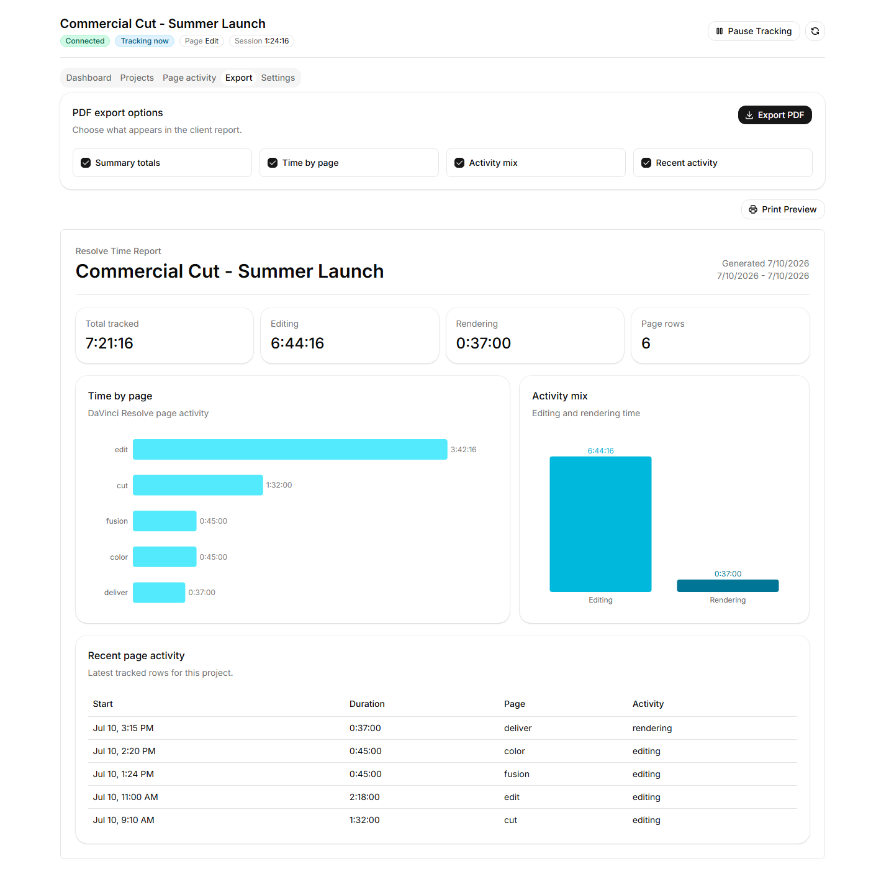
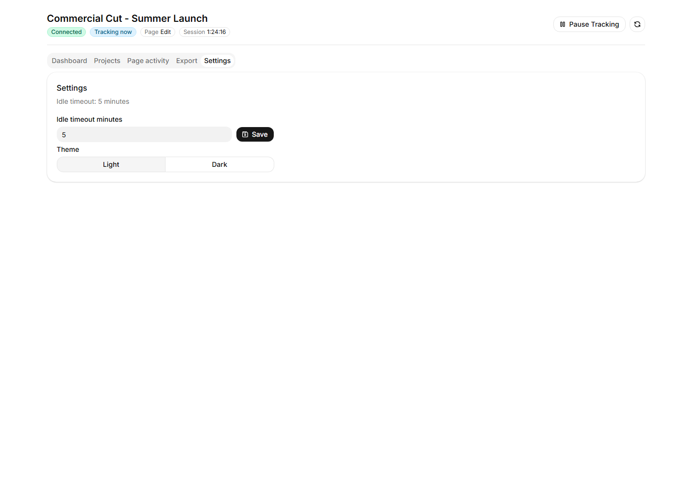

# Installation and usage

[Back to the README](../README.md) · [Release notes](releases/0.1.2-alpha.1.md) · [Troubleshooting](troubleshooting.md)

## Install the published alpha

The [newest published release](https://github.com/Today20092/Davinci-Resolve-TimeTracker/releases/tag/v0.1.2-alpha.1) is **v0.1.2-alpha.1**, a source-only alpha preview. Download and extract its **Source code** archive, or clone the tag:

```sh
git clone --branch v0.1.2-alpha.1 --depth 1 https://github.com/Today20092/Davinci-Resolve-TimeTracker.git
cd Davinci-Resolve-TimeTracker
```

Follow the [development guide's prerequisites and setup](development.md#set-up), then [install the Resolve menu entries](development.md#launch-development-mode-from-resolve). Start the dashboard with [the desktop development command](development.md#run-the-desktop-app) and attach tracking through Resolve's Scripts menu. This source setup requires Git, uv, Python 3.13, and Node.js with the pinned pnpm version. The Windows shortcuts described below belong to the bootstrap installation route.

Before updating, close Resolve and the dashboard and back up `tracker.sqlite3`. For a release update, select the new published tag and repeat the source setup. The bootstrap scripts below update to current `main` instead.

## Requirements

- DaVinci Resolve Studio. Windows with Resolve Studio 21.1.1.10 has been exercised; playback can still be undercounted.
- Git, used to download and update the project.
- Node.js with pnpm, used to build the desktop app. The pnpm version is pinned in `frontend/package.json`.

The installer supplies `uv`, Python 3.13, Python packages, and frontend packages. macOS and Linux support is available but still needs broader real-machine testing; see [Platform Support](#platform-support).

## Install

The bootstrap scripts below follow current `main`, which can advance beyond a published release. For the published alpha, use the [tagged source setup](#install-the-published-alpha).

### Bootstrap current main

On Windows, use the installed **DaVinci Resolve + Time Tracker** shortcut to start Resolve with tracking. Use the separate **Resolve Time Tracker Dashboard** shortcut to view saved time and reports. To attach tracking to an already-open Resolve session, run:

```text
Workspace > Scripts > ResolveTimeTrackerMenu
```

| Platform | Download | Run |
| --- | --- | --- |
| Windows | [install.ps1](https://raw.githubusercontent.com/Today20092/Davinci-Resolve-TimeTracker/main/install.ps1) | Right-click the file and choose **Run with PowerShell**. |
| macOS | [install.sh](https://raw.githubusercontent.com/Today20092/Davinci-Resolve-TimeTracker/main/install.sh) | `sh ~/Downloads/install.sh` |
| Linux | [install.sh](https://raw.githubusercontent.com/Today20092/Davinci-Resolve-TimeTracker/main/install.sh) | `sh ~/Downloads/install.sh` |

Windows users who prefer a one-command install can run:

```powershell
irm https://raw.githubusercontent.com/Today20092/Davinci-Resolve-TimeTracker/main/install.ps1 | iex
```

This downloads and immediately runs the installer. Use the download link above instead if you want to inspect the script before running it.

If Windows blocks `install.ps1`, open PowerShell in your Downloads folder and run:

```powershell
powershell -ExecutionPolicy Bypass -File .\install.ps1
```

The installer downloads the project source, installs Python dependencies, builds the dashboard, and adds the DaVinci Resolve menu script. Windows installation also creates the tracking and dashboard shortcuts and removes legacy tracker login-startup entries.

If Git or Node.js with pnpm is missing, the installer stops before changing the installation and explains what to install.

### When the tracker runs

Tracking starts when you use the tracked Resolve shortcut or Resolve's Scripts menu. There is no login-startup process or watcher waiting for Resolve to open.

The headless runtime records the Resolve session without an Electron window. Opening the dashboard connects to that runtime. If tracking has not started, the dashboard opens saved data without starting tracking.

Closing the dashboard exits Electron. Tracking continues while the tracked Resolve session is open. After Resolve closes, the runtime remains only if the dashboard is still open; closing both ends the runtime. Nothing remains running between sessions. Ordinary dashboard launches use the installed build without running pnpm or rebuilding assets.

For X11 activity detection on Linux, install `xprintidle` and `xdotool` with your distro package manager. Missing tools or unavailable activity information pause billable tracking. Wayland activity detection is unavailable.

### Update

Rerun the same installer you downloaded:

```powershell
.\install.ps1
```

```sh
sh install.sh
```

Restart Resolve if it was already open.

### Uninstall

Download and run the uninstaller for your platform:

| Platform | Download |
| --- | --- |
| Windows | [uninstall.ps1](https://raw.githubusercontent.com/Today20092/Davinci-Resolve-TimeTracker/main/uninstall.ps1) |
| macOS / Linux | [uninstall.sh](https://raw.githubusercontent.com/Today20092/Davinci-Resolve-TimeTracker/main/uninstall.sh) |

```powershell
.\uninstall.ps1
```

```sh
sh uninstall.sh
```

Close Resolve and the dashboard first. The uninstaller shows every location it will remove and asks for confirmation. It separately asks whether to permanently delete `tracker.sqlite3`; choosing No preserves all tracked projects and time.

## Use

On Windows, start **DaVinci Resolve + Time Tracker**. If Resolve is already open, attach tracking with:

```text
Workspace > Scripts > ResolveTimeTrackerMenu
```

Open **Resolve Time Tracker Dashboard** to see whether time is being recorded, the open Resolve project and page, saved work sessions, settings, and report exports. Use **Pause Tracking** to stop the timer manually and **Resume Tracking** to start it again.

The dashboard alone does not start tracking. Starting Resolve through its ordinary shortcut also does not start tracking; use the tracked shortcut or Scripts menu for sessions you want recorded.

CSV export writes closed sessions only. Open active sessions are exported after they close.

## Screenshots

These screenshots use sample project data to show the companion app pages.

<details>
<summary>View app screenshots</summary>

<br>

### Projects



### Page Activity



### Export



### Settings



</details>

## How Tracking Works

- Tracks while Resolve is the foreground app and you are not idle.
- Stops when Resolve is minimized or you switch to another app.
- Keeps tracking during Resolve render/export.
- Stores data locally in SQLite.
- Exports closed sessions to CSV.
- Never records keystrokes, mouse coordinates, screen contents, footage, or media contents.

Automated performance checks use synthetic activity and lifecycle scenarios. They do not measure CPU or memory during a real Resolve editing session.

Default data file:

```text
Windows: %LOCALAPPDATA%\ResolveTimeTracker\tracker.sqlite3
macOS: ~/Library/Application Support/ResolveTimeTracker/tracker.sqlite3
Linux: $XDG_DATA_HOME/ResolveTimeTracker/tracker.sqlite3 or ~/.local/share/ResolveTimeTracker/tracker.sqlite3
```

## Platform Support

- Windows: verified with DaVinci Resolve Studio 21.
- macOS: supported by installer and activity probes, needs real-machine smoke testing.
- Linux: supported by installer and Resolve scripting path; proper idle/focus detection requires `xprintidle` and `xdotool`.

More detail lives in [docs/platform-support.md](platform-support.md).

## Need Help?

See [Troubleshooting](troubleshooting.md) when the Resolve menu item is missing, the tracker is disconnected, or time is not increasing.

For connection or performance problems, open **Settings > Support report** in
the desktop app and choose **Copy report** or **Save report**. Paste or attach
that report to your GitHub issue. It includes runtime and connection details,
but not Resolve project names or tracking history.
